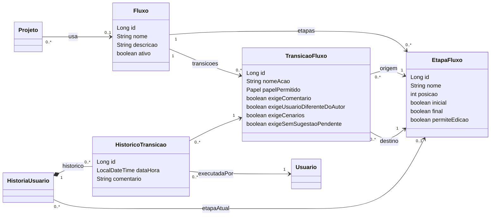

# Atividade bônus: controle de fluxo configurável

Seção 10 do enunciado. Cada história percorre um caminho até a aprovação, e esse caminho
(etapas, transições e condições) fica **cadastrado no banco**, não no código.

## Onde está ativo

Nos dados iniciais, o fluxo **"Aprovação de histórias"** está ligado ao projeto
**"Estúdio BDD"**. O projeto **"Loja"** não usa fluxo e funciona como antes (é nele que foi
executado o roteiro das regras 1 a 7). Um projeto passa a usar um fluxo com
`PUT /api/projetos/{id}/fluxo`.

## Modelo

Alterações nas entidades existentes: `Usuario` ganhou `papel` (ANALISTA ou REVISOR),
`Projeto` ganhou `fluxo` e `HistoriaUsuario` ganhou `etapaAtual` e `historico`.

**Decisão:** o enunciado lista a condição "exige cenários e nenhuma sugestão pendente" como
um atributo só, mas a tabela da seção 10.2 usa as duas condições separadas ("Solicitar revisão
por IA" exige só cenários; "Concluir curadoria" exige só nenhuma pendência). Por isso viraram
duas colunas: `exigeCenarios` e `exigeSemSugestaoPendente`.

## Fluxo inicial (dados iniciais)

| Etapa | Posição | Inicial | Final | Permite edição |
|---|---|---|---|---|
| Rascunho | 1 | sim | não | sim |
| Revisão por IA | 2 | não | não | sim |
| Revisão humana | 3 | não | não | não |
| Aprovada | 4 | não | sim | não |

| Ação | De → Para | Papel | Condições |
|---|---|---|---|
| Solicitar revisão por IA | Rascunho → Revisão por IA | Analista | ao menos um cenário |
| Concluir curadoria | Revisão por IA → Rascunho | Analista | nenhuma sugestão pendente |
| Enviar para revisão | Rascunho → Revisão humana | Analista | ao menos um cenário e nenhuma sugestão pendente |
| Aprovar | Revisão humana → Aprovada | Revisor | usuário diferente do autor |
| Devolver | Revisão humana → Rascunho | Revisor | comentário obrigatório |

Usuários: Ana e Carlos são **analistas**; Beatriz é **revisora**.

## Regras e onde estão no código

| Regra (seção 10.3) | Onde |
|---|---|
| A história nasce na etapa inicial do fluxo do projeto | `HistoriaService.criar` |
| Só é editada em etapas que permitem edição, e nunca na final | `HistoriaService.buscarParaAlterar` (vale para história e cenários) |
| A transição só é executada se existir a partir da etapa atual, se o usuário tiver o papel e se as condições forem atendidas | `FluxoService.executar` |
| O serviço lê os dados do fluxo, sem `if` por etapa | `FluxoService.executar` compara a transição com a etapa atual e lê as colunas `exige...` da transição; nenhum nome de etapa aparece no serviço |
| Toda transição gera um registro de histórico | `HistoriaUsuario.registrarTransicao` |
| Com fluxo ativo, a exportação exige a etapa final | `ExportacaoService.validarExportacao` |
| A API disponibiliza as ações possíveis para a história e o usuário atual | `GET /api/historias/{id}/acoes` |
| Na SPA, um quadro com uma coluna por etapa e botões gerados das transições | `QuadroPagina.jsx` e `PainelFluxo.jsx` |

## Demonstração: nova etapa sem alterar o código

Com a API rodando e o banco zerado, executar em `docs/requisicoes.http`, seção
"Bônus: nova etapa só com dados":

1. Desmarcar "Aprovada" como etapa final (`PUT /api/fluxos/1/etapas/4`).
2. Cadastrar a etapa "Pronta para desenvolvimento", final (`POST /api/fluxos/1/etapas`).
3. Cadastrar a ação "Liberar para desenvolvimento", de "Aprovada" para a nova etapa, para
   revisores (`POST /api/fluxos/1/transicoes`).

Sem reiniciar nada, o quadro do projeto "Estúdio BDD" passa a ter cinco colunas, e uma
história aprovada mostra o botão "Liberar para desenvolvimento" para a revisora.

## Limitações

- Qualquer usuário pode cadastrar etapas e transições (não há papel de administrador).
- Etapas e transições não são excluídas pela API; para tirar uma ação, desativa-se o fluxo do
  projeto.
- O papel do usuário continua vindo da identidade simulada (`X-Usuario-Id`).

## Testes

`FluxoServiceTest`: transição que não sai da etapa atual é rejeitada, aprovação pelo próprio
autor é bloqueada, papel errado é bloqueado, devolver sem comentário é bloqueado, envio com
sugestão pendente é bloqueado, transição válida muda a etapa e registra o histórico, e história
em etapa sem edição não pode ser alterada. `ExportacaoServiceTest` cobre a exportação que só é
permitida na etapa final.
