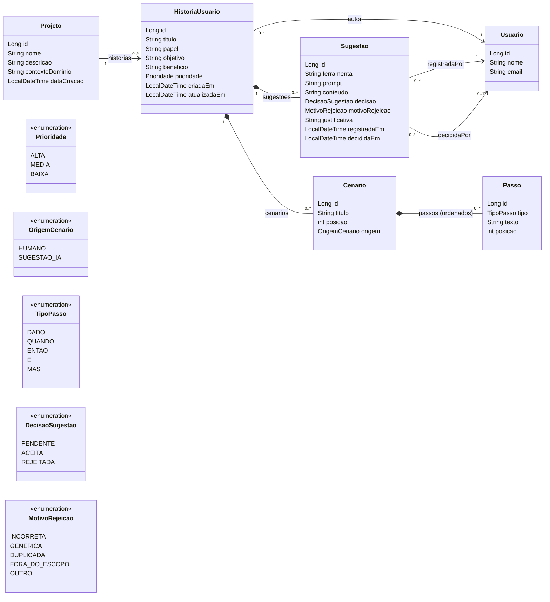

# Diagrama de classes

O GitHub renderiza o diagrama abaixo automaticamente (Mermaid).

## Decisões de modelagem

- **Passo é composição de Cenário**: `cascade = ALL` e `orphanRemoval = true`. Apagar um
  cenário apaga os passos; tirar um passo da lista também o apaga do banco.
- **Ordenação**: `Cenario` e `Passo` têm o campo `posicao`, e as coleções usam
  `@OrderBy("posicao ASC")`, então sempre voltam do banco na ordem certa.
- **Unicidade simples**: `Usuario.email` e `Projeto.nome` têm `unique = true`.
- **Unicidade composta**: o título da história é único por projeto
  (`uk_historia_titulo_projeto`) e o título do cenário é único por história
  (`uk_cenario_titulo_historia`). O serviço também valida antes de salvar, para devolver
  uma mensagem clara em vez de erro do banco.
- **Carregamento**: todos os `@ManyToOne` são `LAZY` (o padrão do JPA seria EAGER).
  Coleções `@OneToMany` já são `LAZY` por padrão. Assim, buscar uma história não traz o
  projeto e o autor inteiros sem necessidade.
- **Projeto → HistoriaUsuario sem cascata**: as histórias são criadas pelo serviço
  individualmente, com validação de título e autoria.
